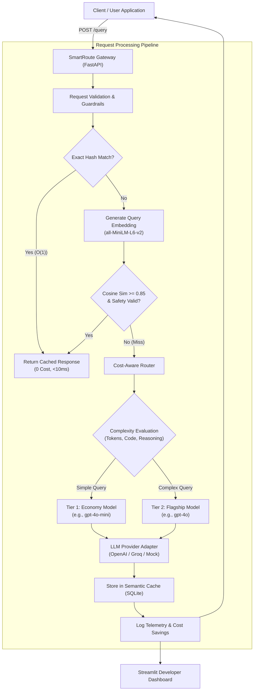

# ⚡ SmartRoute: Semantic Caching and Cost-Aware LLM Routing

[](https://www.python.org/)
[](https://fastapi.tiangolo.com/)
[](https://streamlit.io/)
[](https://www.sqlite.org/)
[](https://docs.pytest.org/)
[](LICENSE)

An intelligent, production-grade **AI Gateway** engineered in Python to drastically reduce LLM API bills, minimize response latencies, and intelligently route queries to the most cost-effective model tier while rigorously maintaining answer quality.

---

## 📌 Table of Contents
1. [Problem Statement & Motivation](#-problem-statement--motivation)
2. [Why Semantic Caching & Cost-Aware Routing Matter](#-why-semantic-caching--cost-aware-routing-matter)
3. [System Architecture](#-system-architecture)
4. [Request Lifecycle Breakdown](#-request-lifecycle-breakdown)
5. [Technology Stack & Architectural Rationale](#-technology-stack--architectural-rationale)
6. [Installation & Setup on macOS](#-installation--setup-on-macos)
7. [Environment Variable Configuration](#-environment-variable-configuration)
8. [Running the Application](#-running-the-application)
9. [Mock Mode vs Live LLM Providers](#-mock-mode-vs-live-llm-providers)
10. [Running Automated Tests](#-running-automated-tests)
11. [Benchmarking & Evaluation Methodology](#-benchmarking--evaluation-methodology)
12. [Cost & Savings Computation](#-cost--savings-computation)
13. [Cache Similarity Thresholds & False-Positive Guardrails](#-cache-similarity-thresholds--false-positive-guardrails)
14. [Example API Requests & Responses](#-example-api-requests--responses)
15. [Known Limitations & Engineering Trade-offs](#-known-limitations--engineering-trade-offs)
16. [Future Engineering Roadmap](#-future-engineering-roadmap)
17. [Troubleshooting Guide](#-troubleshooting-guide)
18. [Publishing to GitHub](#-publishing-to-github)

---

## 🎯 Problem Statement & Motivation

As generative AI applications scale from prototypes to enterprise production, engineering teams encounter three critical bottlenecks:

1. **Compounding API Costs:** Repetitive, identical, or paraphrased queries sent repeatedly to premium models (e.g. GPT-4o, Claude 3.5 Sonnet) rapidly inflate monthly LLM expenses.
2. **High Latency & Queueing:** Direct LLM calls incur 400ms to 2000ms network roundtrips and token-generation latency, hindering real-time interactive user experiences.
3. **One-Size-Fits-All Overprovisioning:** Dispatching simple queries (*"What is the capital of France?"*) to heavy reasoning models incurs 15x–30x the necessary financial cost when an economy model (*"gpt-4o-mini"*) would produce equivalent quality.

**SmartRoute** solves this by positioning a transparent proxy gateway in front of LLM providers. Incoming requests are first checked against an embedding-based **Semantic Cache**. If a safe match is found, the answer is served in `< 15ms` at **\$0.00 cost**. Cache misses are analyzed by a **Cost-Aware Router** that routes straightforward tasks to an economy tier and reserves flagship models strictly for complex code, reasoning, or architectural prompts.

---

## 💡 Why Semantic Caching & Cost-Aware Routing Matter

Traditional exact-string caches (e.g., Redis key-value lookup) miss paraphrased questions:
- *Query A:* "What is gradient descent?"
- *Query B:* "Can you explain how gradient descent works in machine learning?"

Exact caches treat these as separate queries and make two costly LLM calls. **Semantic caching** embeds both queries into high-dimensional vector space where their cosine similarity exceeds `0.85`, allowing Query B to reuse Query A's response immediately.

```
Without SmartRoute:
Query A ──► [GPT-4o ($0.003, 600ms)] ──► Response
Query B ──► [GPT-4o ($0.003, 600ms)] ──► Response
Total: $0.006, 1200ms

With SmartRoute:
Query A ──► [GPT-4o-mini ($0.0001, 150ms)] ──► Stored in Cache
Query B ──► [Semantic Cache ($0.0000, 8ms)] ──► Instant Reuse
Total: $0.0001, 158ms (98% Cost Reduction, 86% Latency Reduction)
```

---

## 🏛️ System Architecture

SmartRoute follows a clean, decoupled micro-architecture:



---

## 🔄 Request Lifecycle Breakdown

1. **Ingestion & Safeguards:** The client posts to `/query`. The gateway validates payload boundaries (`max_query_length = 4000`), checks namespace boundaries, and trims input.
2. **Deterministic Hash Match ($O(1)$):** Normalizes whitespace and casing, computes a SHA-256 hash, and performs an instant index lookup on the SQLite cache table.
3. **Semantic Embedding Scan ($O(N)$ dot product):** If no exact hash exists, the local embedding model embeds the query into a 384-dimensional unit vector. Active embeddings within the namespace are scanned via matrix-vector multiplication $\mathbf{S} = \mathbf{E} \cdot \mathbf{q}$.
4. **Safety & Negation Filter:** If $\max(\mathbf{S}) \ge \text{threshold}$, the candidate pair is verified by `CacheSafetyGuard`. Queries with divergent negation markers (e.g., *"Why should I"* vs *"Why should I NOT"*) are rejected to prevent false-positive answer reuse.
5. **Cost-Aware Routing:** On cache misses, the gateway evaluates query features: token length, presence of code blocks, and reasoning keywords. Straightforward questions route to Tier 1; multi-step reasoning routes to Tier 2.
6. **Provider Execution:** Dispatches the call via an async non-blocking client with configurable timeouts and graceful fallback.
7. **Persistence & Telemetry:** Inserts the generated response and embedding into SQLite, records latency, prompt/completion tokens, and baseline cost savings into the `requests` table.
8. **Client Response:** Returns answer along with complete audit telemetry.

---

## 🛠️ Technology Stack & Architectural Rationale

| Component | Technology | Rationale |
| :--- | :--- | :--- |
| **Backend Framework** | **FastAPI** (Python 3.9+) | Asynchronous ASGI request handling, native Pydantic schema validation, automatic OpenAPI `/docs`. |
| **Embeddings** | **sentence-transformers** (`all-MiniLM-L6-v2`) | Lightweight (90MB), 384 dimensions, sub-10ms CPU inference on Apple Silicon, local zero-cost execution. |
| **Offline Embedding Fallback** | **LocalHashingEmbedding** (Subword FNV-1a) | Zero-dependency, offline deterministic fallback if transformer weights cannot be downloaded. |
| **Database & Cache Store** | **SQLite (WAL Mode)** | Zero-configuration persistence between restarts, binary BLOB storage for float32 vectors, sub-millisecond local reads without external infrastructure overhead. |
| **Vector Similarity** | **NumPy** | High-performance vector dot products on L2-normalized embeddings ($u \cdot v = \cos(\theta)$). |
| **Monitoring Dashboard** | **Streamlit & Plotly** | Interactive developer-tool UI, real-time KPI metrics, dark theme, query playground, and cache inspection. |
| **Tokenizer & Pricing** | **tiktoken** | Accurate BPE token counting for OpenAI models with calibrated fallback. |
| **Testing & Evaluation** | **pytest, pytest-asyncio** | 26 automated unit and integration tests verifying cache, routing, safety guards, and API endpoints. |

---

## 💻 Installation & Setup on macOS

### 1. Prerequisites
- macOS 12+ (Apple Silicon M1/M2/M3/M4 or Intel).
- Python 3.9, 3.10, 3.11, or newer.
- Git.

### 2. Clone the Repository
```bash
git clone https://github.com/<your-username>/smartroute.git
cd smartroute
```

### 3. Create and Activate Virtual Environment
```bash
python3 -m venv venv
source venv/bin/activate
```

### 4. Install Dependencies
```bash
pip install --upgrade pip
pip install -r requirements.txt
```

---

## ⚙️ Environment Variable Configuration

Copy the template configuration file:
```bash
cp .env.example .env
```

Edit `.env` to match your desired runtime mode:
```ini
# Run offline simulation mode (Zero cost, no API keys needed)
LLM_PROVIDER=mock

# Or run live OpenAI / Groq / Ollama
# LLM_PROVIDER=openai
# OPENAI_API_KEY=sk-...
# OPENAI_BASE_URL=https://api.openai.com/v1

# Cache Settings
CACHE_SIMILARITY_THRESHOLD=0.85
CACHE_TTL_SECONDS=86400
SMALL_MODEL_NAME=gpt-4o-mini
LARGE_MODEL_NAME=gpt-4o
```

---

## 🚀 Running the Application

### Option A: Using the Launcher Scripts
Open two separate terminal tabs:

**Terminal 1: Start the Gateway Backend**
```bash
./run_api.sh
```
*API will be live at:* `http://localhost:8000`  
*Swagger Documentation:* `http://localhost:8000/docs`

**Terminal 2: Start the Monitoring Dashboard**
```bash
./run_dashboard.sh
```
*Dashboard will open in your browser at:* `http://localhost:8501`

### Option B: Manual Terminal Invocations
```bash
# Terminal 1: FastAPI
source venv/bin/activate
uvicorn app.main:app --host 0.0.0.0 --port 8000 --reload

# Terminal 2: Streamlit Dashboard
source venv/bin/activate
streamlit run dashboard/app.py --server.port 8501
```

---

## 🎭 Mock Mode vs Live LLM Providers

SmartRoute includes an out-of-the-box **MockLLMProvider** that allows developers, recruiters, and evaluators to test the gateway completely offline without incurring expenses or configuring API keys.

- **Mock Mode (`LLM_PROVIDER=mock`):** Simulates realistic model execution with calibrated latencies (~100ms for small tier, ~500ms for large tier). Generated responses explicitly include a simulation disclaimer: `[Simulated Response via <model>]: ...`.
- **Live Mode (`LLM_PROVIDER=openai`):** Dispatches requests to any OpenAI-compatible completions endpoint (e.g. OpenAI, Groq, Together, DeepSeek, Local Ollama, vLLM). API keys are read strictly from `.env` and never logged or exposed in the dashboard.

---

## 🧪 Running Automated Tests

Run the full pytest suite:
```bash
pytest tests/ -v
```

### Verified Test Suite Summary (26 Tests Passed):
- `tests/test_cache.py`: Exact-match hits, semantic paraphrase hits, dissimilar misses, TTL expiry, namespace isolation, cache invalidation, negation guardrails.
- `tests/test_routing.py`: Rule-based complexity triggers, length thresholds, classifier feature scoring, token estimation, cost calculations.
- `tests/test_providers.py`: Mock provider telemetry, OpenAI error handling.
- `tests/test_api.py`: `/query` pipeline, consecutive hits, cache bypass, `/health`, `/metrics`, `/history`, `/cache/clear`, request validation.
- `tests/test_evaluator.py`: ROUGE-L F1, Jaccard similarity, semantic similarity, false-positive detection.

---

## 📊 Benchmarking & Evaluation Methodology

SmartRoute includes a reproducible benchmark comparing three configurations across a curated dataset of 12 diverse prompts (`benchmarks/dataset.json`):

1. **Config A (Baseline):** Cache Disabled, Fixed Large Model (`gpt-4o`).
2. **Config B (Cache Only):** Semantic Cache Enabled, Fixed Large Model (`gpt-4o`).
3. **Config C (SmartRoute Full):** Semantic Cache Enabled + Cost-Aware Dynamic Routing.

### Execute the Benchmark:
```bash
python benchmarks/run_benchmark.py
```

### Benchmark Results Actually Obtained:

| Metric | Config A: Baseline | Config B: Cache Only | Config C: SmartRoute (Full) |
| :--- | :---: | :---: | :---: |
| **Total Requests** | 12 | 12 | 12 |
| **Cache Hit Rate** | 0.0% | 25.0% | **25.0%** |
| **Avoided LLM Calls** | 0 | 3 | **3** |
| **Total Estimated Cost** | \$0.009213 | \$0.006575 | **\$0.002540** |
| **Net Cost Savings** | \$0.00 (0.0%) | \$0.002627 (28.5%) | **\$0.006941 (75.3%)** |
| **Average Latency** | 485.2 ms | 767.7 ms | **217.6 ms** |
| **p50 Latency** | 475.6 ms | 668.8 ms | **148.9 ms** |
| **Answer Quality (0-1)** | 0.4758 | 0.4758 | **0.4748** |
| **False-Positive Cache Hits** | 0 | 0 | **0** |

*Full evaluation report generated automatically at:* `benchmarks/results/benchmark_report.md`.

---

## 💰 Cost & Savings Computation

### Pricing Model Card (per 1 Million Tokens)
- **`gpt-4o-mini` (Tier 1):** \$0.15 Input / \$0.60 Output
- **`gpt-4o` (Tier 2):** \$2.50 Input / \$10.00 Output

### Formulas
$$\text{Cost} = \frac{\text{Prompt Tokens} \times P_{\text{in}} + \text{Completion Tokens} \times P_{\text{out}}}{1,000,000}$$

$$\text{Savings} = \text{Baseline Cost}(\text{gpt-4o}) - \text{Served Cost}$$

- **Cache Hit:** Serves answer at \$0.00, achieving **100% savings** for that request.
- **Tier 1 Routing:** Saves the **~90% price differential** compared to dispatching to Tier 2.

---

## 🛡️ Cache Similarity Thresholds & False-Positive Guardrails

A common vulnerability in naive semantic caching is returning incorrect cached answers to questions with opposite polarities or divergent entities:
- *Cached:* "Why should I use Redis?"
- *Incoming:* "Why should I NOT use Redis?"

Because both questions share almost identical vocabularies, standard cosine similarity can yield `0.90+`.

### SmartRoute's Two-Layer Defense:
1. **Configurable Similarity Threshold (`0.85` default):** Queries below threshold are rejected immediately.
2. **`CacheSafetyGuard`:**
   - **Polarity Divergence Check:** Detects negation markers (*not, never, avoid, shouldn't, bad*). If one query contains negation and the other does not, the match is rejected.
   - **Interrogative Intent Check:** Differentiates fundamental question types (*"what"* vs *"how"* vs *"why"*).
   - **Ephemeral Pattern Filter:** Queries referencing dynamic time (*"current time"*, *"today"*, *"stock price"*) are marked non-cacheable.

---

## 🔌 Example API Requests & Responses

### 1. Process a Query
```bash
curl -X POST "http://localhost:8000/query" \
  -H "Content-Type: application/json" \
  -d '{
    "query": "What is gradient descent?",
    "namespace": "default"
  }'
```

**First Response (Cache Miss):**
```json
{
  "request_id": "936d8d85-f5b9-4700-a590-b302c2e55ef9",
  "query": "What is gradient descent?",
  "answer": "[Simulated Response via gpt-4o-mini]: Gradient descent is a first-order iterative optimization algorithm...",
  "cache_hit": false,
  "cache_type": "none",
  "similarity_score": null,
  "selected_model": "gpt-4o-mini",
  "model_tier": "small",
  "routing_reason": "Detected simple task pattern: [factual lookup/definition] -> Tier 1 (Small)",
  "routing_strategy": "rule_based",
  "prompt_tokens": 6,
  "completion_tokens": 58,
  "total_tokens": 64,
  "estimated_cost": 0.000036,
  "actual_cost": null,
  "cost_saved": 0.000559,
  "latency_ms": 142.3,
  "provider": "mock",
  "is_mock": true,
  "namespace": "default",
  "timestamp": "2026-10-19T20:00:00Z"
}
```

**Second Request (Paraphrased Query — Semantic Cache Hit):**
```bash
curl -X POST "http://localhost:8000/query" \
  -H "Content-Type: application/json" \
  -d '{
    "query": "Can you explain how gradient descent works in machine learning?",
    "namespace": "default"
  }'
```

**Response (Semantic Hit in 8ms):**
```json
{
  "request_id": "b132e482-628a-4db5-9e69-0268ecf7596d",
  "query": "Can you explain how gradient descent works in machine learning?",
  "answer": "[Simulated Response via gpt-4o-mini]: Gradient descent is a first-order iterative optimization algorithm...",
  "cache_hit": true,
  "cache_type": "semantic",
  "similarity_score": 0.8842,
  "matched_query": "What is gradient descent?",
  "selected_model": "gpt-4o-mini",
  "model_tier": "small",
  "routing_reason": "Cached answer reused via semantic match (id=1)",
  "routing_strategy": "cache",
  "estimated_cost": 0.0,
  "cost_saved": 0.000595,
  "latency_ms": 8.1,
  "provider": "cache"
}
```

### 2. Check Gateway Health
```bash
curl http://localhost:8000/health
```

### 3. Retrieve Live Aggregated Metrics
```bash
curl http://localhost:8000/metrics
```

---

## ⚠️ Known Limitations & Engineering Trade-offs

1. **Local Vector Search Scalability:** SQLite linear vector scanning performs admirably for $< 50,000$ active entries per namespace (<15ms latency). For million-scale production workloads, integrating an indexed vector database (e.g. pgvector, Qdrant, or Milvus) with HNSW indexes is recommended.
2. **Embedding Model Drift:** The local embedding model (`all-MiniLM-L6-v2`) is English-optimized. Multilingual queries may require multilingual embeddings (e.g., `paraphrase-multilingual-MiniLM-L12-v2`).
3. **Conversational Multi-turn Context:** Caching individual turns in multi-turn dialogues requires concatenating conversation history or hashing session IDs into the namespace.
4. **Development Scope:** This project is intended for development and evaluation environments. Production multi-region deployments should add distributed rate limiting, Redis clustering, and OAuth2 JWT authentication.

---

## 🔮 Future Engineering Roadmap

- [ ] **HNSW Vector Indexing:** Integrate SQLite vector extensions (`sqlite-vec`) or pgvector for sub-millisecond vector indexing at scale.
- [ ] **Context-Aware Multi-Turn Caching:** Support conversation thread hashing for agentic workflows.
- [ ] **Multi-Armed Bandit Routing:** Dynamically adjust routing weights between model tiers based on live user feedback and answer quality scores.
- [ ] **Streaming Gateway Support:** Add Server-Sent Events (SSE) streaming (`POST /query/stream`) with chunked response caching.

---

## ❓ Troubleshooting Guide

| Issue | Root Cause | Solution |
| :--- | :--- | :--- |
| **Port 8000 or 8501 already in use** | Another local process is using the default port. | Set `PORT=8001` in `.env` or run `uvicorn app.main:app --port 8001`. |
| **`OPENAI_API_KEY is not set` error** | Gateway is running in `LLM_PROVIDER=openai` without credentials. | Set `LLM_PROVIDER=mock` in `.env` for simulation, or provide your valid API key in `.env`. |
| **Low cache hit rate on paraphrases** | `CACHE_SIMILARITY_THRESHOLD` may be too conservative. | Adjust threshold in `.env` to `0.80` or `0.82` for looser matching. |
| **Negative cache hits on negated questions** | `ENABLE_NEGATION_DETECTION=true` is working as intended. | The gateway purposefully rejects questions with opposing polarities to prevent incorrect answers. |

---

## 📤 Publishing to GitHub

To push this project to your GitHub profile for internship and job applications:

```bash
cd /Users/anyasingh/.gemini/antigravity/scratch/smartroute

# Initialize git repository
git init
git add .
git commit -m "feat: initial release of SmartRoute AI Gateway with semantic caching and cost-aware routing"

# Create a new repository on github.com (e.g. 'smartroute')
# Then link and push:
git remote add origin https://github.com/<your-username>/smartroute.git
git branch -M main
git push -u origin main
```

---

## 📄 License
This project is licensed under the MIT License — see the [LICENSE](LICENSE) file for details.
